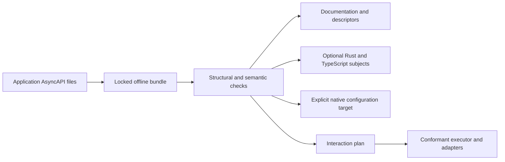

# Authoring and using the contract

This is the proposed v0.2 format for Draft [ADR#8612050910](../README.md). The [decisions](./decisions.md) close its
design questions. The [field reference](./profile-reference.md) and [runtime semantics](./runtime-semantics.md) define
their meaning. Draft is the approval state, not permission to guess unspecified behavior. No generator or executor is
certified here.

## Write one application file

Author `asyncapi/asyncapi.yaml`. Standard AsyncAPI 3.1.0 owns addresses, messages, schemas, directions and replies. The
extension owns the additional subject and interaction semantics. Here is an excerpt:

```yaml
channels:
  reviewRequests:
    address: demo.v1.{scopeId}.peer.{peerId}.review.request
    parameters:
      scopeId:
        description: Scope containing the recipient.
      peerId:
        description: Intended logical peer.
x-nats-contract:
  version: 0.2.0-draft
  tokenTypes:
    ScopeId:
      kind: token
      alphabet: lower
      first: letter
      minLength: 1
      maxLength: 32
      prefix: ''
    PeerId:
      kind: token
      alphabet: lower
      first: letter
      minLength: 1
      maxLength: 32
      prefix: ''
  channels:
    reviewRequests:
      parameters: { scopeId: ScopeId, peerId: PeerId }
      filters:
        byScope: demo.v1.{scopeId}.peer.*.review.request
```

The [complete example](./example.md) includes fields omitted from this excerpt. Addresses appear once; named filter
builders have separate subscription shapes. Scope lab and peer alfa produce `demo.v1.lab.peer.alfa.review.request`.
Publish builders reject empty, dotted, wildcard and whitespace peer values. A filter can render
`demo.v1.lab.peer.*.review.request`, but grants no subscription permission. The finite grammar replaces the regex-based
v0.1 sketch so both languages use identical rules.

## Read, validate and optionally generate



The source remains useful without generation. The selected implementation direction is a profile-owned compiler with one
normalized model and deterministic Rust/TypeScript backends. Initial outputs are subject/filter value objects,
parse/render functions, descriptors and immutable source backlinks. Illustrative names are
`ReviewRequestsSubject::new(scope_id, peer_id)` and `reviewRequests.subject({ scopeId, peerId })`; these are proposed
generated APIs, not existing SDK methods. Broker clients, payload models and execution are separate capabilities. An
execution target cannot silently downgrade unsupported semantics.

## Link independently owned applications

The coordinator describes its own sends/receives; a separate worker contract describes the real counterpart. Exact
imports and explicit links connect those views without reversing directions. A bundle includes both documents and their
dependencies. Its lock pins exact bytes. All references resolve inside it, including external native configuration and
workflow source. An external resource has one authority and is compared without rewriting its owner's configuration. A
running registry is optional for discovery; it is unnecessary for interpreting the bundle offline.

## Distinguish transport and exchange

Publication API, capture, consumption and application completion are separate facts. Core publication lacks storage
PubAck, but a matching stream may capture it. JetStream publication requires the declared storage confirmation. Core
subscribers see live traffic; declared consumers add replay/acknowledgment rules. Native-inbox Core RPC ends on its
first checked response or timeout. Business results use explicit result operations and the interaction's
correlation/completion policy.

The example includes live/durable consumption views and online/durable interaction variants. Their promises follow from
resources, state and adapters, not subject labels. A worker's standard reply describes responding; sender requestReply
metadata describes waiting. The same subject can participate in Core and JetStream views.

## Walk through a group review

A caller supplies scope, group, document reference and an invocation key. The runtime authenticates it, generates an
operation ID and resolves/authorizes a snapshot such as alfa, bravo and charlie. It freezes that set, rejects impossible
thresholds, and fills subject/payload/control fields through explicit bindings. Every peer receives an identified
branch. Result subjects include the publishing peer; complete verified publish permissions supply the identity evidence.

Two distinct approved branches satisfy the example quorum. Duplicate approval adds no vote. Wrong peer, stale
attempt/fence, invalid payload and closed-operation results are rejected. Timeout follows the declared partial/failure
rule. Membership additions do not change thresholds. Atomic provider-side time guards resolve races at the serialized
state transition boundary.

The online variant has memory state, one attempt and no recovery/offline promise. The durable variant persists
manifest/outbox, uses independent per-peer delivery and can resume. Uncertain publication keeps its attempt identity; a
permitted logical retry increments attempt/fence while preserving its branch. Neither variant implies exactly-once
business effects.

Early decision is separate from sibling settlement. Cancellation replies distinguish stopped, already-completed and
unknown. A pipeline waits at its declared boundary, transforms typed output into the next input and stops on
partial/failed/indeterminate outcome. A publication stage completes on its declared confirmation, not subscriber
processing.

## Pattern coverage

- Unicast: one authorized peer and direct dispatch.
- Multicast: a selected authorized group with independent branches.
- Broadcast: the authorized scope with explicit sender/offline inclusion.
- Fan-out: independent recipient obligations, with a durable binding when promised.
- Anycast: one eligible assignee and one branch preserved across fenced reassignment.
- Scatter: an explicit identified manifest with branch-specific input.
- Gather: an authenticated expected manifest and correlated results without new dispatch.
- Scatter-gather: dispatch plus a declared completion and closure rule.
- Pub/sub and pipelines: standard topic operations and typed stages; general graphs reuse locked Open Workflow 1.0.4
  documents.

These dimensions compose. A single mutually exclusive pattern string would lose audience, ownership or completion
meaning.

## Decisions and evidence

The [decision record](./decisions.md) closes packaging, domains/overlap, bindings, authority, membership,
identity/adapters, durable recovery, leases/retries, completion/cancellation, workflow reuse, generation and check-stage
choices. The [conformance reference](./conformance.md) states what fixtures must prove. Structural schemas and offline
checks establish their checked static slices. Broker/effect/runtime claims need a conformant provider run.
Implementation work remains; there are no unanswered policy choices hidden behind it. Missing required capabilities fail
admission.

## Sources

Standard fields follow [AsyncAPI 3.1.0](https://www.asyncapi.com/docs/reference/specification/v3.1.0) and its
[NATS binding](https://github.com/asyncapi/bindings/blob/master/nats/README.md). Subject/permission foundations follow
[NATS subjects](https://docs.nats.io/concepts/subjects) and
[authorization](https://docs.nats.io/learn/security/authorization). Added profile/control/execution rules are proposals
defined here.
