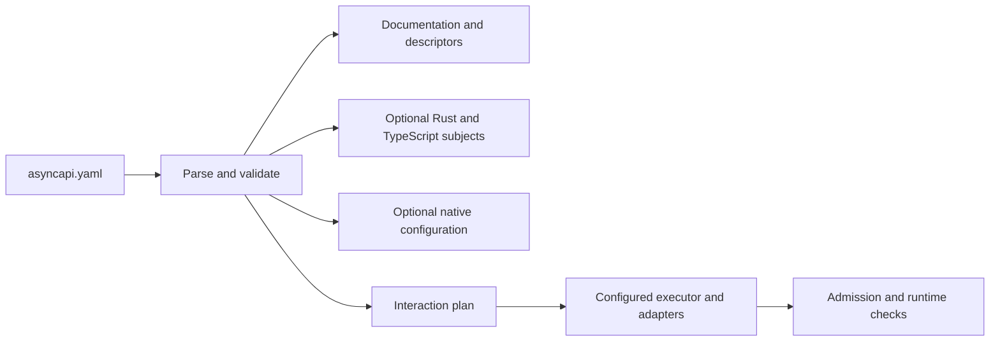

# Proposed application contract file

This is a concrete, experimental proposal for Draft [ADR#8612050910](../README.md). The profile name, fields and version
are proposed here. They are not an official AsyncAPI or NATS specification, and no generator or executor implements
them.

An application authors **one `asyncapi.yaml`** containing standard AsyncAPI definitions and an `x-nats-contract`
extension. The complete [example file](./example.md) describes a review coordinator. The
[profile JSON Schema](./profile-schema.md) describes the extension's structure. The surrounding document is validated
against AsyncAPI separately.

## What someone writes

The standard channel owns its subject address. The extension supplies the parameter domain and permitted filters:

```yaml
channels:
  reviewRequests:
    address: demo.v1.{scopeId}.peer.{peerId}.review.request
    parameters:
      scopeId:
        description: Scope containing the recipient.
      peerId:
        description: Intended logical peer.
x-nats-contract:
  version: 0.1.0-draft
  tokenTypes:
    ScopeId:
      pattern: '^[a-z][a-z0-9_-]{0,31}$'
    PeerId:
      pattern: '^[a-z][a-z0-9_-]{0,31}$'
  channels:
    reviewRequests:
      parameters: { scopeId: ScopeId, peerId: PeerId }
      filters:
        byScope: demo.v1.{scopeId}.peer.*.review.request
```

This is an excerpt; the complete example includes the required messages, operations and other profile fields. An author
writes the address once. A named filter is a separate allowed subscription shape, so it can contain wildcards. The
domain mapping means `peerId` is a `PeerId`, rather than an arbitrary replacement string.

With `scopeId = lab` and `peerId = alfa`, the concrete address is `demo.v1.lab.peer.alfa.review.request`. The `byScope`
filter for `lab` is `demo.v1.lab.peer.*.review.request`. A publish builder rejects `alfa.extra`, `*`, empty strings and
whitespace as `PeerId` values. Building a filter does not authorize subscribing to it.

## What happens to the file



The file is usable as documentation immediately. A future generator can resolve references, construct an intermediate
model, and emit subject APIs or descriptors. Infrastructure tooling may provision declared resources when explicitly
configured to do so. A configured executor would interpret interactions using supplied adapters. Reading the file or
generating a library does not start subscriptions, create streams or execute work.

Suggested generated surfaces are `ReviewRequestsSubject::new(scope_id, peer_id)` in Rust and
`reviewRequests.subject({ scopeId, peerId })` in TypeScript, plus a separately typed `byScope` filter constructor. These
names are illustrative generated APIs, not existing SDK methods. Both languages must accept and reject the same values,
render the same bytes and parse addresses back into the same domain values.

## File boundary and identity

The proposed application location is `asyncapi/asyncapi.yaml`, following Draft
[ADR#1427717799](../../1427717799/README.md). Inside this ADR, the example lives in `assets/` as supporting material.

- `asyncapi` selects the standard document version, currently `3.1.0` for this proposal.
- `id` identifies the application contract. `info.version` identifies its application revision.
- `x-nats-contract.version` selects the proposed profile semantics, currently `0.1.0-draft`.
- Channel, operation, adapter and interaction keys are stable identifiers within that contract revision.

Profile map keys refer to existing standard channel/operation keys where stated below. Other local references are
literal identifiers. Fields named `schema`, `inputSchema` or `outputSchema` contain local JSON Pointers into
`components.schemas`; they are not executable expressions. Correlation locations use the specified message expressions.
For this draft, custom references stay inside the document; cross-application composition remains an open question.
Draft revisions may change without compatibility guarantees. Any evaluation pins the entire bundle by commit or content
digest as well as its declared versions.

The instance is self-contained for its declared schemas and policies. Interpreting it also requires this version of the
profile definition and schema. A portable bundle includes those files. Connection configuration, credentials, actual
membership and implementations of the named adapters are explicit deployment dependencies.

## Standard definitions and profile-owned fields

Keep addresses in standard `channels`, operation direction in standard `operations`, and payload definitions in standard
`components`. Operation `action` is from the described application's perspective. The example sends review requests and
receives results; it does not invent another application's receive operation by reversing those roles.

AsyncAPI parameters describe address substitution; the profile supplies domain constraints. Standard NATS queue
metadata, when applicable, stays under `operations.<id>.bindings.nats`, with its binding version pinned. This proposal
does not add JetStream fields to reserved standard NATS binding objects.

### Token types and channel mappings

`tokenTypes` maps domain names to anchored `pattern` constraints. Every concrete subject parameter is exactly one
nonempty token. Dots, whitespace, `*` and `>` are forbidden in parameter values regardless of the declared pattern. This
draft additionally restricts parameter values to ASCII letters, digits, `_` and `-`. Substitution neither escapes nor
normalizes input. Case is preserved. In this draft, patterns must use a portable ASCII subset: literals, character
classes, grouping, alternation and bounded repetition; no flags, lookarounds or backreferences. A generator rejects
patterns outside its supported subset instead of changing their meaning.

`channels.<channelId>.parameters` maps every address parameter to a token type. Its keys must exactly match the standard
channel's parameters and address placeholders. Literal tokens and placeholders must occupy entire dot-separated tokens.
An unknown/dynamic address, such as a native reply inbox, is not emitted as a normal subject builder.

`filters` maps names to permitted filter templates. A filter's placeholders use the channel's token types. `*` occupies
one complete token; `>` can occur only as the final complete token and matches a nonempty suffix. Literal/filter
compatibility with the channel family must be checked. When token-domain constraints are narrower than broker routing,
the filter can also receive out-of-contract addresses; parse and message validation still apply.

### Publication, subscription and request/reply

`operations.<operationId>` contains exactly one of `publish` or `subscribe`, matching standard `action`:

- `publish: {api: core, confirmation: none}` selects ordinary Core publication without a JetStream storage
  acknowledgment.
- `publish: {api: jetstream, confirmation: stream-ack, stream: completed}` requires a JetStream publication
  acknowledgment from the referenced stream. It says nothing about a peer's application result.
- `subscribe: {api: core}` selects a live Core subscription. A standard queue binding may distribute those deliveries.
- `subscribe: {api: jetstream, consumer: completedAudit}` selects the referenced JetStream consumer and its native
  acknowledgment policy. The initial example is a durable pull consumer.

The example's `publishCompleted`, `observeCompleted` and `auditCompleted` use the same channel. Its matching stream
captures publications, its live observer sees Core traffic, and its durable consumer can replay retained events. A Core
publisher could also publish to that channel; it would lack the requested storage acknowledgment.

`requestReply` is optional on a Core sending operation with a standard `reply` definition. In this draft it declares
`routing: native-inbox`, `completion: first-response` and a positive `timeoutMs`. The reply channel has `address: null`.
The NATS adapter allocates/subscribes to a fresh inbox, sets the native NATS reply subject and closes that request on
its first response or timeout. The native reply subject is not an invented application `replyTo` header. A response
still requires schema and configured authorization checks. A first response is separate from quorum or first-success
gathering. JetStream publication uses the reply path for its storage acknowledgment; this version models its business
results through an explicit result operation rather than combining native inbox RPC with the JetStream publish helper.

The RPC binding alone does not establish the responder's logical peer identity; receiver ownership and response trust
need an explicit deployment or adapter contract before advertising that guarantee. A first response that fails
validation fails that RPC; it does not change the rule into waiting for a successful response.

An operation without `requestReply` must not have a standard `reply` in this profile version. Review results are
explicit application messages on a separate result channel. They are correlated by the interaction, rather than reduced
to the standard client's first-response request helper.

### Streams and consumers

`streams` maps local resource identifiers to native stream configurations. `consumers` maps local identifiers to
`{stream, config}`, where `stream` refers to a local stream and `config` contains native consumer fields. These inline
declarations are the authority for those resources in this example. Time values such as `max_age` use native
nanoseconds; profile fields ending in `Ms` use milliseconds.

The structural schema leaves native configuration extensible. Native schema/version validation, supported server
features, effective defaults, account/domain binding and deployed resource drift require separate checks. A consumer
with no `deliver_subject` is pull-based; a configured delivery subject indicates push behavior. A generated native
configuration does not establish that a resource exists. Referencing externally owned resource configurations needs a
separately defined immutable-reference form; it is not silently inferred by this draft.

### Adapter contracts

`adapters` names versioned interfaces for audience resolution, authorization, result verification, selection, ownership,
delivery, aggregation or transformation. Each entry includes `kind`, `version`, `inputSchema`, `outputSchema` and a
description of its obligations. These are proposed dependency interfaces, not available packages or broker services.
Their schema references describe values; they do not implement the policy. Context schemas that are deliberately broad
in the example still need refinement before interoperable implementations are possible.

For example, `verifiedResults` must bind a result to its authenticated logical peer and expected branch. A `peerId` in
JSON does not provide that proof, and a received NATS message does not automatically expose the publisher's
authenticated identity. A deployment needs a compatible verification mechanism, such as verified message evidence or
trusted ingress. Admission fails when a required adapter/capability is unavailable; falling back to trusting the payload
is prohibited.

## Interaction rules

`interactions` defines coordinatable work. An interaction names its `requestOperation`, optional `resultOperation`,
typed `inputs`, audience policy, dispatch rule, delivery state, correlation and completion. A gather-only interaction
omits `requestOperation` and uses `dispatch.mode: none` with an existing branch manifest. An interaction with no
application results uses `completion.mode: none`.

### Inputs, audience and branches

An input has `source: argument` or `source: generated`, plus exactly one of `tokenType` or `schema`. Generated values
still have constraints. The example generates a fresh `operationId`; the caller supplies scope, group and document
reference. Coordinator identity and trusted authorization/verification context come from the configured runtime, never
unchecked caller assertions.

`audience.kind` is `peer`, `group` or `scope`. `input` names the selector input; `scopeInput` names its scope. The named
`resolver` resolves candidates and `authorization` checks dispatch and result admission. The version requires
`membership: snapshot-at-admission` and `lateJoiners: exclude`. `includeSender` and `offline` determine candidate
inclusion. The snapshot records distinct authorized logical peers. `onRevocation: cancel-open-branches` makes a revoked
peer's open branch terminal without accepting later results from it. Membership snapshots do not freeze authorization
forever.

`dispatch.mode` selects behavior:

- `direct`: one identified target. Admission rejects an audience with a cardinality other than one.
- `independent`: create an independently tracked branch for every selected recipient.
- `one-eligible`: select one eligible peer using a named `selector` adapter; define reassignment/claim requirements
  through the delivery/ownership binding. A selected peer and broker queue distribution are distinct mechanisms.
- `branches`: consume a typed `branchesInput` containing identified branches, recipients and branch-specific inputs.
- `none`: gather an existing, authorized manifest from `branchesInput` without dispatching requests.

A `branchesInput` schema must describe an array of objects with required `branchId`, `peerId` and `input` fields. The
branch's `input` schema must match its request payload bindings. Branch IDs must be unique, and every recipient must
belong to the admitted authorized audience.

`branchKey: recipient` uses the selected peer identity as the branch key within the operation. `branchKey: declared`
uses unique branch IDs from the manifest. A branch ID is unique within its operation, rather than globally.
`targetParameter` names the request subject parameter filled from the selected recipient. Other subject parameters bind
to same-named interaction inputs. The initial profile has no general expression/template language for binding values.

Request payload fields matching declared inputs receive those values; the declared correlation locations receive the
operation, branch, attempt and peer values. Every other required payload field must have a documented binding before
execution. With `branches`, branch-specific inputs provide those fields. Conflicting assignments or unbound required
fields fail semantic validation. These binding rules are proposed here, not supported behavior of AsyncAPI generators.

### Delivery, ownership and result admission

The example chooses `delivery.mode: online-best-effort`, `state: memory`, `restart: fail-unknown` and `maxAttempts: 1`.
Requests use Core. A selected peer can disconnect after admission, a request/result can be lost, and a coordinator
restart can lose its in-memory state. There is no offline-delivery or crash-recovery promise. Detaching a branch does
not undo business work that might already have happened.

`durable-per-recipient` requires a versioned `delivery.adapter`, durable state and `restart: resume`. The adapter must
define independent recipient delivery records, consumer lifecycle, retention/expiry and recovery. Shared work queues
alone do not meet that declaration. `delivery.ownership` can name an ownership adapter for claims, fencing and
stale-owner result handling. This draft does not define a universal claim protocol. Missing ownership semantics cannot
be inferred from an anycast label. Retry scheduling is also deferred: this version permits execution only with
`maxAttempts: 1`.

`correlation` defines the message locations of operation, branch, attempt and peer identity. A result `verifier` is
required when the interaction collects results. The initial draft requires the same locations in request and result
payloads. Received results must match the frozen manifest, intended recipient and current authorization. The executor
accepts at most one terminal result per logical branch. Repeated attempts/messages do not add votes. Invalid or
duplicate results do not advance completion.

### Completion and closure

Completion modes are `none`, `first-success`, `all-terminal`, `all-successful` and `quorum`. `none` means dispatch
finishes without waiting for application results; it is not proof of receipt. Other modes require a result operation, a
verifier, a declared success predicate and a bounded deadline. `success` is a field-location/equality predicate, not
arbitrary code.

`unit` is `distinct-branches` or `distinct-peers`. Quorum requires a positive `count`; admission rejects a count
exceeding the admitted possible units. A peer with multiple branches contributes at most one successful vote when the
unit is `distinct-peers`. `all-terminal` waits for every expected unit to be terminal and may include failures;
`all-successful` requires success from every expected unit. An empty audience is rejected in this draft. Failure,
revocation and timeout are terminal outcomes even when no peer result arrives.

For `distinct-peers`, any successful branch supplies that peer's vote. A peer is terminal only after all its branches
are terminal. This keeps successful-vote counting distinct from waiting for complete settlement.

`deadlineMs` starts when the admitted manifest is frozen, before dispatch. The admission check and snapshot publication
must form one logical step; dispatch failures become branch outcomes. `onImpossible: fail` closes a success-requiring
operation when remaining possible units cannot satisfy its rule. It does not prematurely close `all-terminal`, which
waits for terminal outcomes. `onTimeout` selects failed closure or a partial result. A partial result is not success.
`lateResults: discard` prevents reopening a closed operation.

`remaining: detach` stops waiting for unfinished branches after early closure. `remaining: cooperative` additionally
requires a `cancelOperation` binding with defined acknowledgment and failure behavior. A cancellation request does not
prove that remote work stopped. Such a binding must be specified before that capability is advertised as executable.

`aggregation` names an adapter that converts accepted outcomes and coordinator context into the documented result. The
example's summary includes operation identity, distinct approved peers and `quorum-met`, `partial` or `failed`.

## Walk through the example

Call `reviewGroup` with `scopeId = lab`, `groupId = reviewers` and a document reference. Suppose admission resolves and
authorizes the online peers `alfa`, `bravo` and `charlie`, excluding the sender. It freezes those peers and creates an
operation such as `op42` with branches `alfa`, `bravo` and `charlie`, all on attempt `1`.

The request to `alfa` uses `demo.v1.lab.peer.alfa.review.request`. Its payload carries the document reference, `op42`,
branch `alfa`, attempt `1` and peer `alfa`. All branches return to `demo.v1.lab.review.op42.result`. The result schema
and verifier decide whether a result can enter the accepted set.

Two distinct approved branches meet the quorum. A duplicate approval from `alfa` contributes no extra vote. The executor
closes successfully, detaches any unfinished branch and discards later results. If only one approval exists at the
deadline, the result is partial. If too few branches remain capable of approval, the operation fails earlier.

`pipelines.reviewAndAnnounce` then publishes a completion event only after successful review completion. Pipeline
`steps` run in array order: a step references either an interaction or an operation. A following `inputAdapter`
transforms the previous step's typed result into the next payload. Same-named subject inputs, such as `scopeId`, remain
invocation context. The first step consumes pipeline inputs. `onFailure: stop` prevents later steps after failed or
partial closure. A publication step completes according to its declared publication confirmation; it does not wait for
subscribers to finish processing. The initial profile defines sequences; richer workflow graphs remain candidates for
standard reuse. An operation step must be a sending operation in this version; an unbounded receive subscription is not
a finite stage.

## Coverage of the required patterns

- **Unicast:** `audience.kind: peer`, `dispatch.mode: direct`; declare whether completion is dispatch-only or a result.
- **Multicast:** `audience.kind: group`, with snapshot/authorization rules and independent dispatch.
- **Broadcast:** `audience.kind: scope`; resolve all authorized peers under the declared sender/offline rules.
- **Fan-out:** independent branches and a delivery policy for each recipient; durable obligations require the durable
  adapter binding.
- **Anycast:** `dispatch.mode: one-eligible`, with explicit selection and any required ownership binding.
- **Scatter:** `dispatch.mode: branches` for an identified manifest, or per-recipient branch expansion.
- **Gather / fan-in:** `dispatch.mode: none`, an existing expected manifest, result correlation and a completion rule.
- **Scatter-gather:** dispatch plus correlated gathering; `reviewGroup` combines multicast, scatter and quorum
  gathering.
- **Pub-sub / pipelines:** standard operations define topic communication; sequential `pipelines` compose stages and
  their typed transformations. Branching/join behavior can live in an interaction; broader workflow composition remains
  separately specified.

These are combinations of dimensions, rather than mutually exclusive pattern strings. A declaration is not an executor
capability claim. A runtime must report unsupported combinations before accepting an invocation.

## Validation and evidence boundary

- **Parse:** reject duplicate YAML keys, invalid syntax and references leaving the declared bundle.
- **Standard structure:** validate AsyncAPI, message/schema references and standard operation/reply relationships.
- **Profile structure:** validate `x-nats-contract` against the supplied JSON Schema. Unknown profile fields fail.
- **Semantic checks:** resolve keys and schema pointers; check parameter domains, filters, action/binding agreement,
  branch bindings, correlation locations, payload compatibility, stream/consumer associations and required adapters.
- **Admission:** resolve and authorize actual peers, freeze membership, reject empty/impossible audiences and confirm
  required delivery/verification capabilities before dispatch.
- **Deployment/runtime:** verify account permissions, server/native configurations and resource drift, then enforce and
  observe identity, ownership, deduplication, completion, deadlines, closure and actual business effects.

The JSON Schema implements only structural checks for the profile. Semantic validation, generation, provisioning and
execution are not implemented by this ADR. Adapter contexts, durable delivery/ownership protocols, cancellation
bindings, cross-application references and broader workflow composition need further specification. A consumer can
support subject generation without supporting interaction execution, provided it states that capability boundary
explicitly.

## Sources

Standard fields and extension locations follow
[AsyncAPI 3.1.0](https://www.asyncapi.com/docs/reference/specification/v3.1.0). Queue metadata and reserved binding
objects follow the [NATS binding](https://github.com/asyncapi/bindings/blob/master/nats/README.md). Concrete subjects
and wildcards follow [NATS subjects](https://docs.nats.io/concepts/subjects). Native inbox behavior follows
[NATS request/reply](https://docs.nats.io/learn/core-nats/request-reply). Stream and consumer fields follow the
[NATS stream](https://github.com/nats-io/nats.docs/blob/master/nats-concepts/jetstream/streams.md) and
[consumer](https://github.com/nats-io/nats.docs/blob/master/nats-concepts/jetstream/consumers.md) references. The added
profile fields and interaction rules are proposals defined in this document.
